<a href="https://schniefs-portfolio.de/">
  <picture>
    <source media="(prefers-color-scheme: dark)" srcset="./assets/banner-dark.svg">
    <source media="(prefers-color-scheme: light)" srcset="./assets/banner-light.svg">
    
  </picture>
</a>

  
  
  
  

## `PLAYER PROFILE`

I build modern, responsive web applications that don't just look good but work cleanly. Clean structures, readable code and practical projects that actually work matter most to me.

- **Class:** Fullstack Developer · Frontend Architect · TypeScript Enthusiast
- **Base:** Germany · remote-ready and open to exciting web development projects
- **Training:** projects from my further training at the Developer Akademie
- **Learning mode:** always on

> **DE** · Ich baue moderne, responsive Webanwendungen, die nicht nur gut aussehen, sondern sauber funktionieren. Mehr auf [schniefs-portfolio.de](https://schniefs-portfolio.de/de).

## `LOADOUT`

<table>
  <tr>
    <td valign="top" width="33%">
      <b>Frontend</b>  
      
      
      
      
      
      
      
      
      
      
    </td>
    <td valign="top" width="33%">
      <b>Backend</b>  
      
      
      
      
      
    </td>
    <td valign="top" width="33%">
      <b>Data &amp; Tools</b>  
      
      
      
      
      
      
    </td>
  </tr>
</table>

## `LEVEL SELECT` · Missions

Every mission runs live. Full briefings with screenshots are on [schniefs-portfolio.de](https://schniefs-portfolio.de/en#projects).

### Academy projects

Projects from my training at the Developer Akademie, each live on its own subdomain.

| Level | Mission | Genre | Loadout | Launch |
| :---: | --- | --- | --- | --- |
| 01 | **Join** Kanban board from a group project: create tasks, move them via drag and drop and assign them to the team. | Kanban task board · team | Angular, TypeScript, Firebase | [Live](https://join.schniefs-portfolio.de/) · [Repo](https://github.com/YvesGM/join-developer-academy) |
| 02 | **Sharkie** Object-oriented jump-and-run: collect coins and poison bottles and face the killer whale. | Jump-and-run game | JavaScript, HTML Canvas, CSS | [Live](https://sharky.schniefs-portfolio.de/) · [Repo](https://github.com/YvesGM/sharky-the-game-developer-akademie-project) |
| 03 | **Memory** Responsive memory game with themes, several board sizes and a local two-player mode. | Memory game | TypeScript, Vite, SCSS | [Live](https://memory.schniefs-portfolio.de/) · [Repo](https://github.com/YvesGM/memory-game-developer-academy-project) |
| 04 | **Pokédex** Web app built on the PokéAPI that fetches, presents and catalogues Pokémon data. | API library | JavaScript, REST API | [Live](https://pokedex-api.schniefs-portfolio.de/) · [Repo](https://github.com/YvesGM/modular-api-driven-frontend-architecture-showcase) |
| 05 | **Poll App** Survey app with single and multiple choice, deadlines and live results via Supabase Realtime. | Survey app | Angular, TypeScript, Supabase | [Live](https://poll-app.schniefs-portfolio.de/) · [Repo](https://github.com/YvesGM/poll-app-developer-academy) |

### Personal

My own websites, live on their own domains and connected to my platform **Schnief Enterprise** (Next.js + React frontends, Django + PostgreSQL backend). Idea, concept, design direction and sign-off are mine; built AI-assisted with my own development pipeline. Source code is private.

| Mission | Genre | Briefing | Launch |
| --- | --- | --- | --- |
| **SchniefWare** | Shop for digital products | Online shop for Obsidian vaults, Business OS templates and web design kits, bilingual with light and dark mode. | [schnief-ware.de](https://schnief-ware.de/) |
| **ArohTech** | Art and 3D printing | Website and shop for art and functional 3D-printed products such as trading card holders, with four switchable site styles. | [aroh-tech.de](https://aroh-tech.de/) |
| **Iron Company** | Clan portal | Clan portal of Iron Company (FECO) from War Thunder: public clan pages and a protected member area. | [fe-comp.de](https://fe-comp.de/) |
| **Schnief-News** | Market analysis platform | Scenario-based market analysis with an Elliott-wave focus, a documented history and a community – deliberately not a signal service. | [schnief-news.de](https://schnief-news.de/) · [Showcase repo](https://github.com/YvesGM/schnief-news-showcase) |

## `CO-OP MODE`

Interested in working together or have questions about my projects? Send me a message:

- **Portfolio:** [schniefs-portfolio.de](https://schniefs-portfolio.de/) (contact form in DE / EN)
- **Email:** [contact@schniefs-portfolio.de](mailto:contact@schniefs-portfolio.de)
- **LinkedIn:** [Yves G.](https://www.linkedin.com/in/yves-g-5724533b0/)
- **Fiverr:** [der_schnief](https://www.fiverr.com/der_schnief) – Obsidian vaults, AI image series, web app design kits and Business OS templates

<code>Built with code, coffee and WASD.</code>

